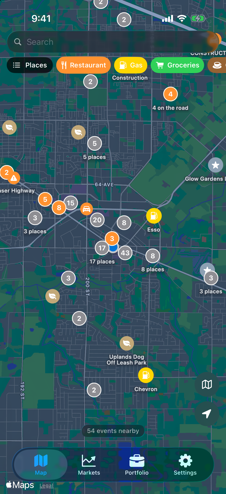
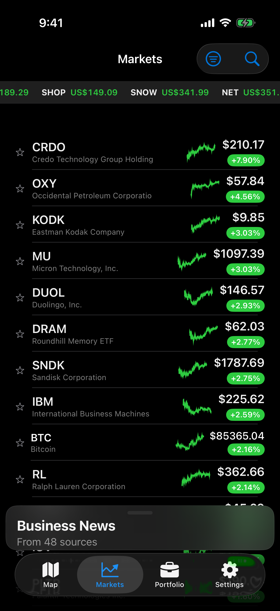
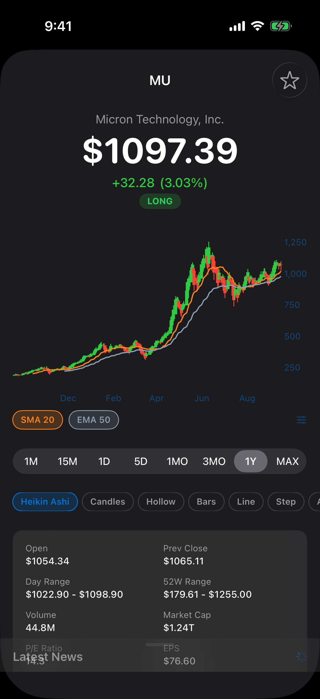
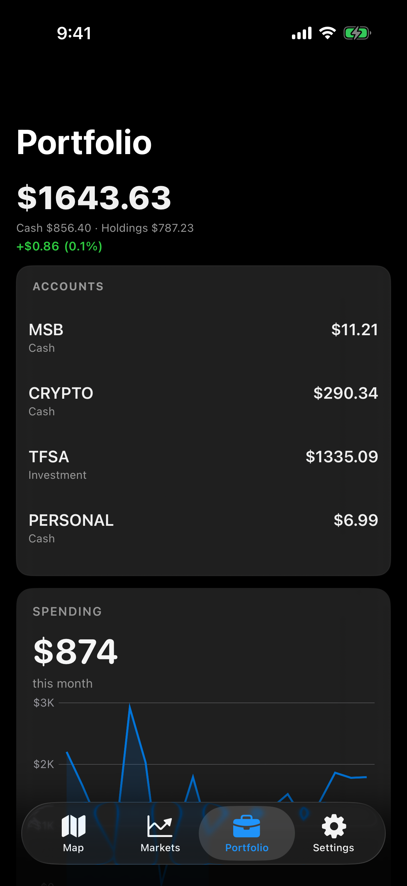
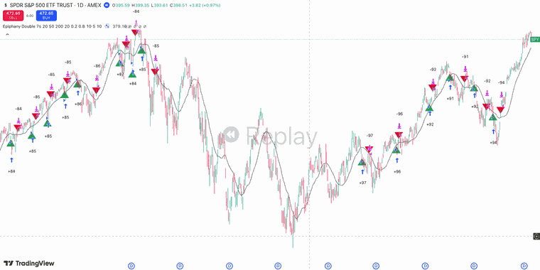

[](https://epiphany.jaybulb.com) [](https://apps.apple.com/app/epiphany/id6779522175) [](https://apps.apple.com/app/epiphany/id6779522175) [](LICENSE)

Everything happening in your world, on one screen. The map, the markets, the people.

[Live](https://epiphany.jaybulb.com) | [App Store](https://apps.apple.com/app/epiphany/id6779522175) | [Whitepaper](WHITEPAPER.md)

<p align="center">
  
  
  
  
</p>

## Features

- **Situation.** A live map of flights, weather, news and incidents, plus a daily brief.
- **Markets.** Stocks, crypto and commodities, each with a Buy, Hold or Sell read. Index cards, top movers, full-screen charts and price alerts.
- **Portfolio.** Holdings, net worth and where the money went.
- **People.** Search anyone and see how they connect.
- **Autopilot.** The trading algorithm, on paper money, scored against the S&P 500.

Web, iPhone, iPad, Mac and Apple Watch. Free to start, $1 once for everything.

## Does the trading work?

One rule survived years of data it had never seen: **Double 7s.** In a rising market, buy a 10 day low and sell a 10 day high. About 70% of its trades make money, across 429 stocks, 16 index funds and Bitcoin.

It still does not beat buying and holding. Run as one account it grew about 3% a year against 15% for SPY. The full test, failures included, is in the [whitepaper](WHITEPAPER.md#5-benchmark-does-it-work).

<p align="center">
  
</p>

## Run it

```bash
npm install && npm run dev
npm test -- --run
npm run build && npx wrangler deploy
```

Docs live in [docs/](docs/). Chart control builds on [tradingview-mcp](https://github.com/tradesdontlie/tradingview-mcp) (MIT), see [THIRD_PARTY.md](THIRD_PARTY.md).

## License

Apache 2.0, 2026, Joshua Trommel
