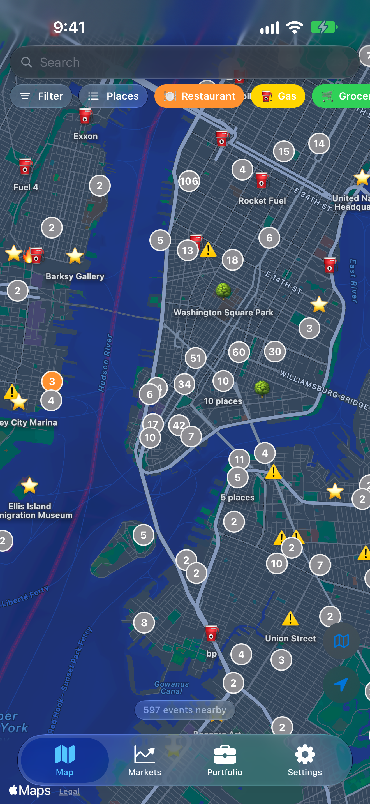
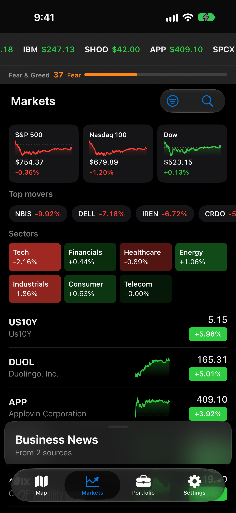
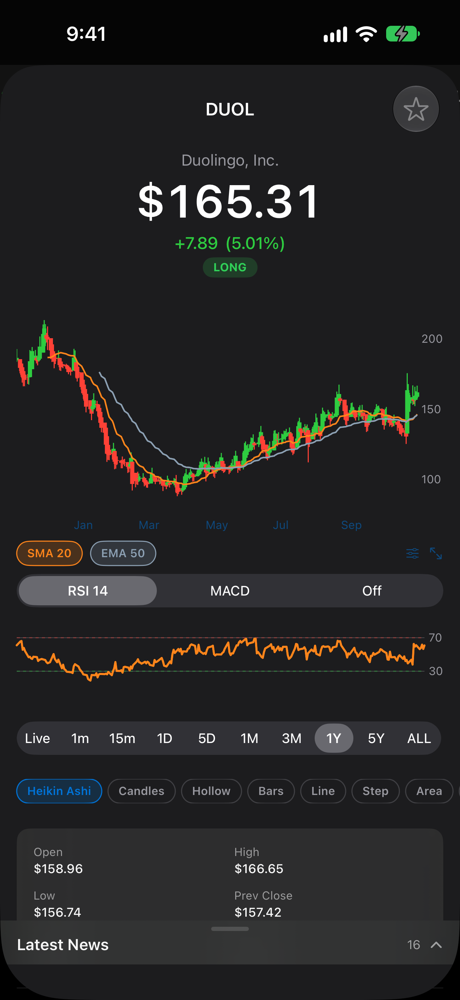
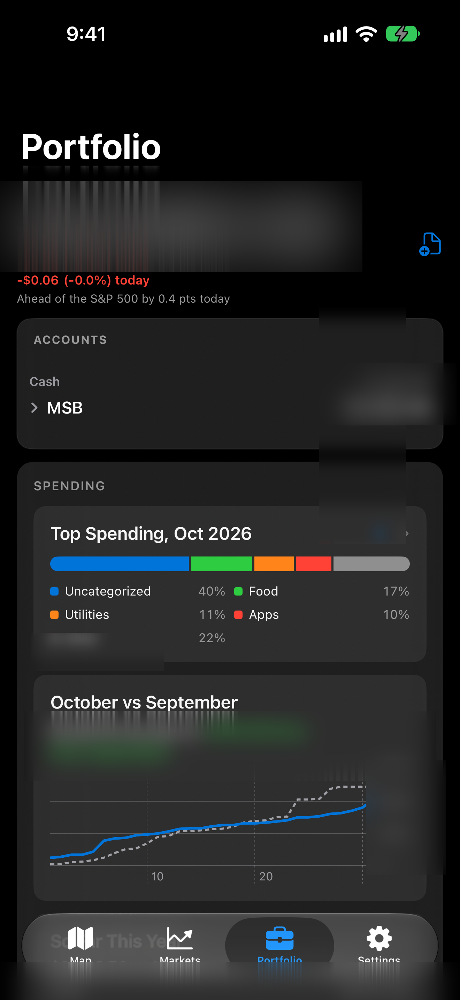

[](https://epiphany.jaybulb.com) [](https://apps.apple.com/app/epiphany/id6779522175) [](LICENSE)

Your world on one screen: the map, the markets and your money.

<p align="center">
  
  
  
  
</p>

- **Map:** flights, weather, news and incidents around you, live.
- **Markets:** stocks, crypto and commodities with full-screen charts and alerts.
- **Portfolio:** your brokerage synced read only, net worth and spending.
- **Autopilot:** the trading rule on paper money, scored against the S&P 500 ([whitepaper](WHITEPAPER.md)).

Web, iPhone, Mac and Apple Watch. Free, Pro from $1.99 a month.

## Run

```bash
npm install && npm run dev
npm test -- --run
npm run build && npx wrangler deploy
```

Docs are in [docs/](docs/), open work in [roadmap.md](roadmap.md). Apache 2.0, Joshua Trommel.
