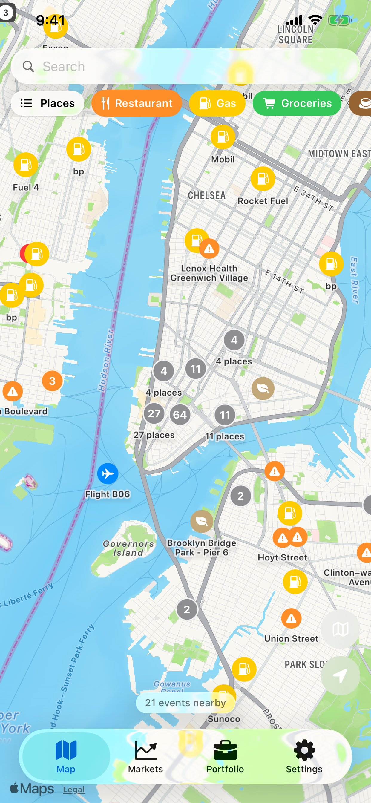
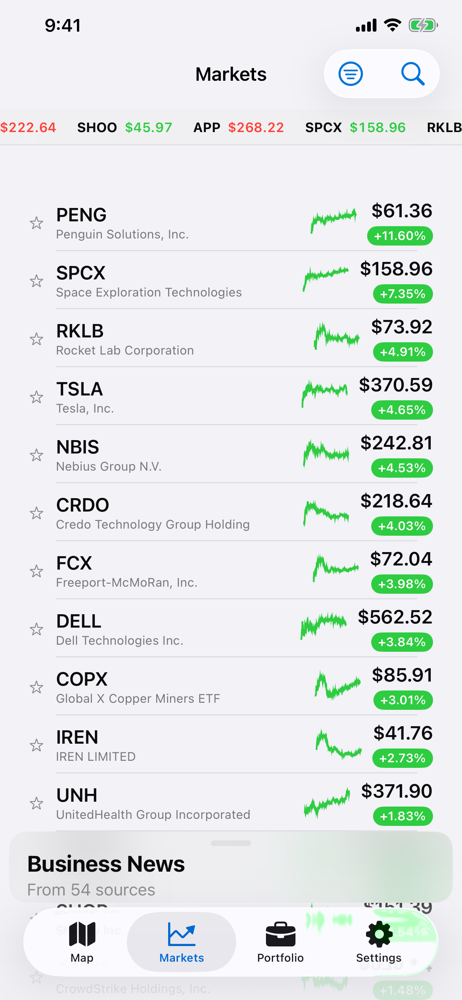
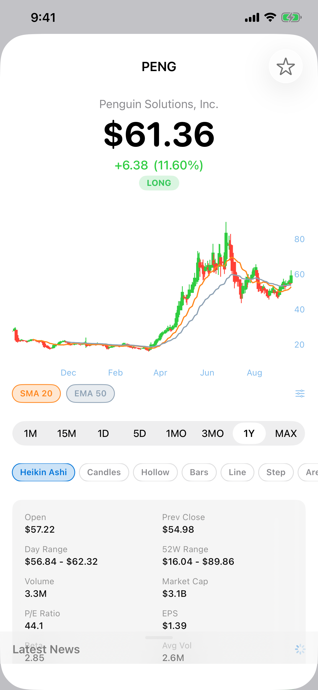
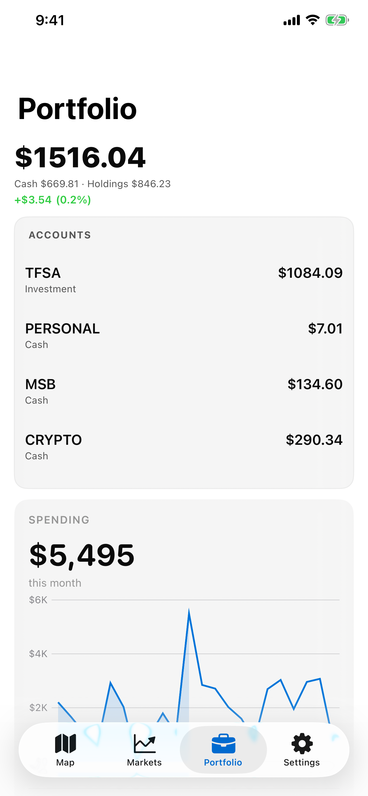
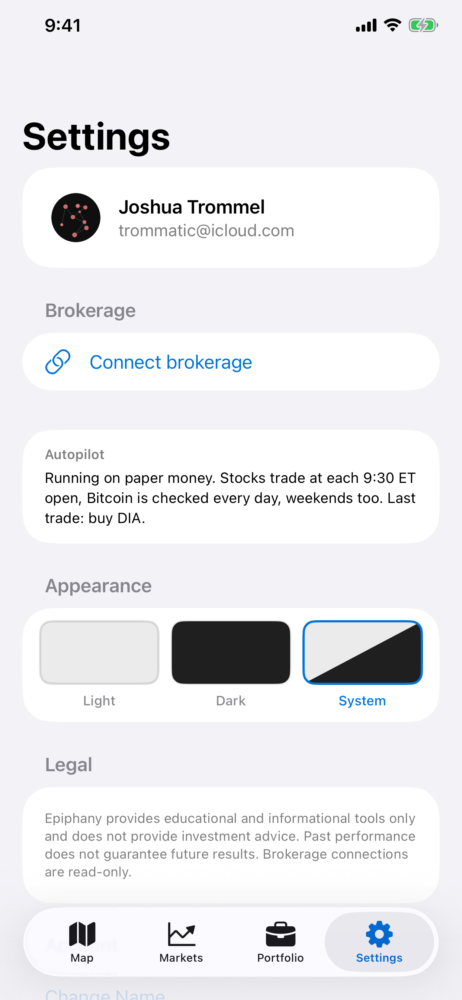

 [](https://apps.apple.com/app/epiphany/id6779522175)

<p align="center">
  
  
  
  
  
</p>

Epiphany for iPhone. What's happening around you and in the markets, on one screen.

## Features

- **Situation.** A live map: flights pointed where they fly, weather, events, incidents, traffic, quakes and fires. Tap a place for Look Around and drive time.
- **Markets.** Stocks, crypto and commodities with index cards, top movers and Fear & Greed. Charts go full screen and you can drag to read any point.
- **Alerts.** Price alerts fire even with the app closed.
- **Portfolio.** Spending, holdings, budget and statements.
- **Watch.** A complication for any symbol.

## Run

```bash
xcodegen generate && open Epiphany.xcodeproj
```

Build notes and rules for agents are in [CLAUDE.md](CLAUDE.md).
